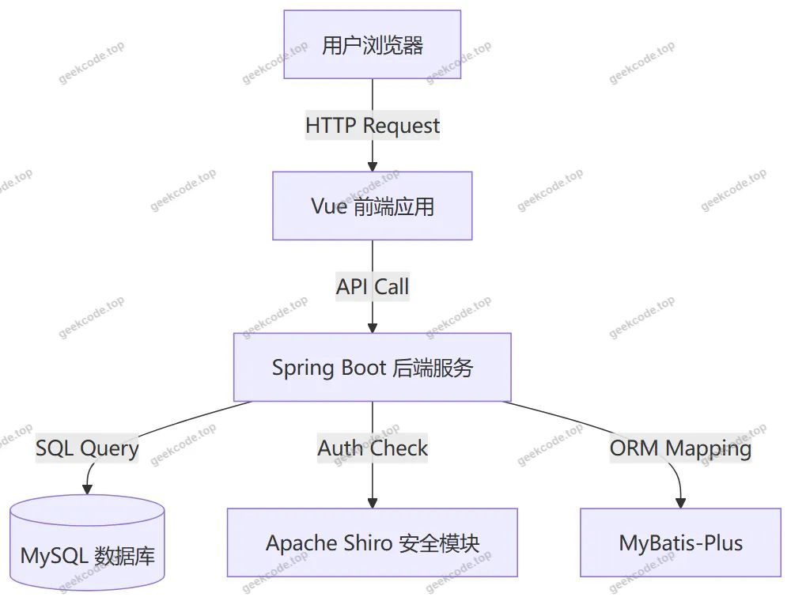
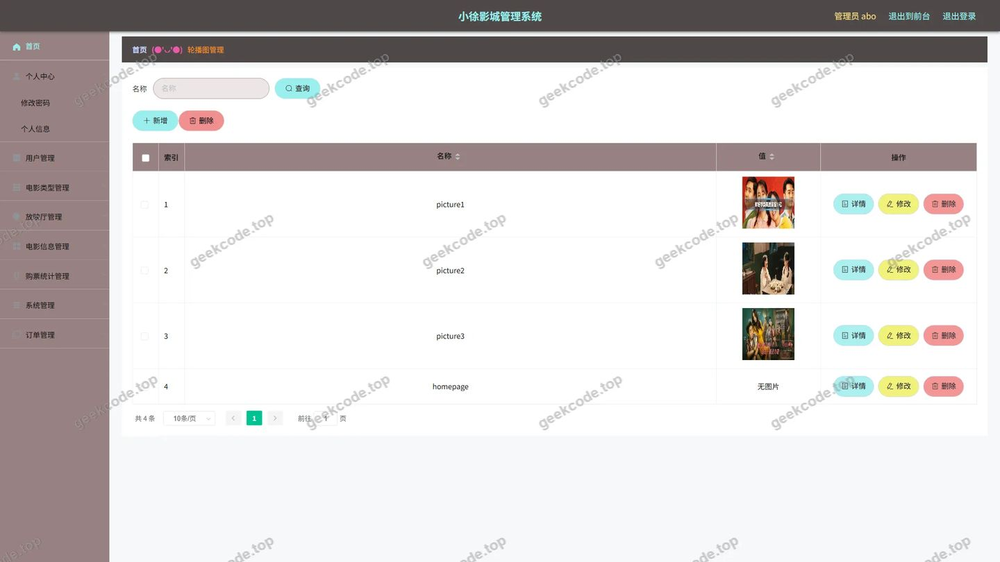
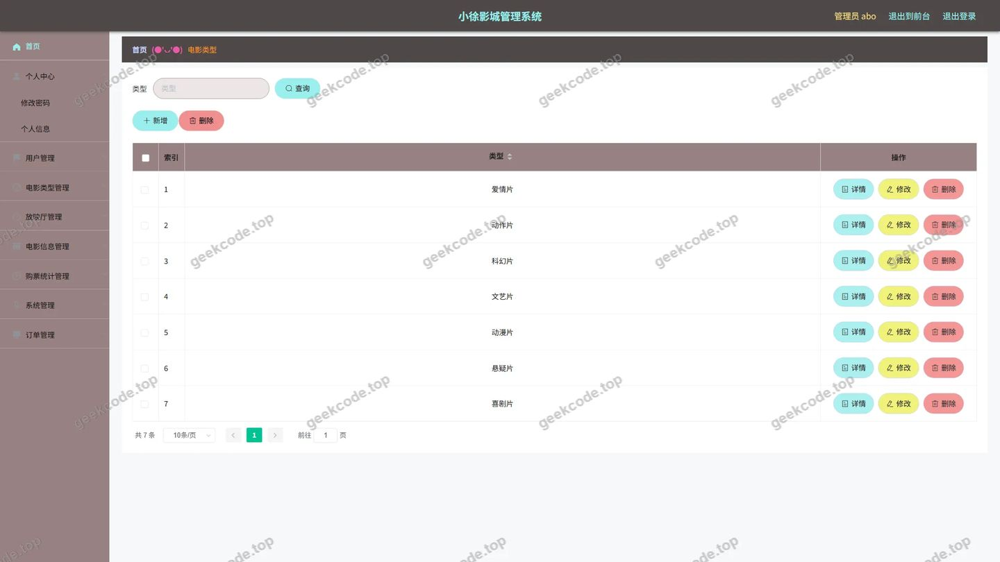
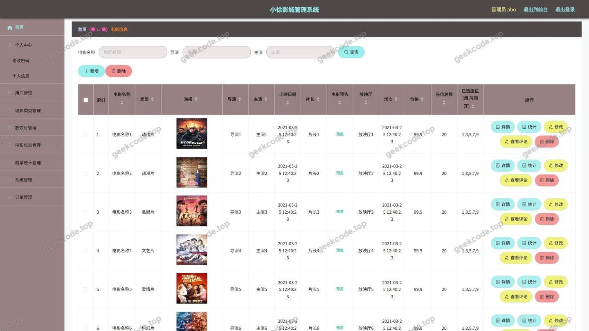
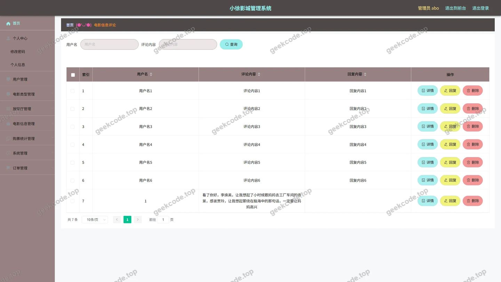
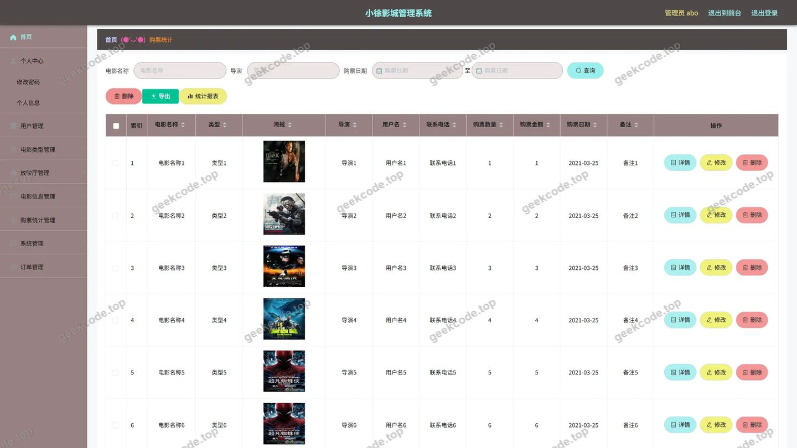
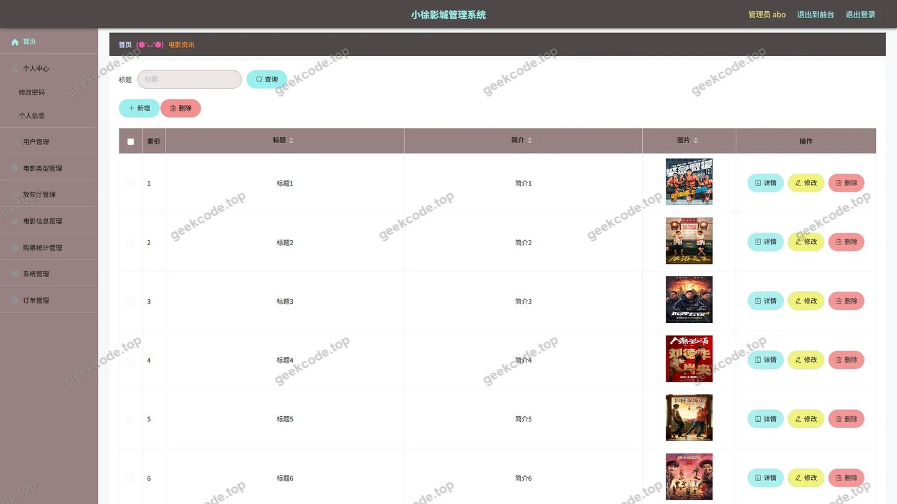

# 小徐影城管理系统

> 🎓 **计算机毕业设计 · 小徐影城管理系统**
>
> 本仓库只放**项目介绍 + 运行截图**（截图是站点带水印的原图，存在仓库 `images/` 里）。
>
> 👉 **完整可运行源码 / 数据库脚本 / 部署文档：[点我获取](https://geekcode.top/archives/%E5%B0%8F%E5%BE%90%E5%BD%B1%E5%9F%8E%E7%AE%A1%E7%90%86%E7%B3%BB%E7%BB%9F?utm_source=github)**
>
> 💬 咨询微信：**ir9372**　|　🌐 更多项目：[极客代码 geekcode.top](https://geekcode.top/?utm_source=github)
>
> 📌 项目详情页：<https://geekcode.top/archives/%E5%B0%8F%E5%BE%90%E5%BD%B1%E5%9F%8E%E7%AE%A1%E7%90%86%E7%B3%BB%E7%BB%9F?utm_source=github>

<table><td width="230" align="center"> <b>扫码加微信 ir9372</b></td><td valign="middle">📦 源码 = 项目介绍 + 全部运行截图 + 数据库 + 部署文档 👉 点上方任意截图，直接跳到 <b>极客代码 geekcode.top</b> 详情页</td></table>

---

<h1>小徐影城管理系统</h1>
<h2>项目概述</h2>

小徐影城管理系统旨在构建一个集电影资讯展示、在线选座购票、订单管理及后台运营于一体的综合性影院服务平台。系统采用前后端分离架构，面向普通观众提供便捷的观影服务，同时为管理员提供高效的业务管理能力。核心功能涵盖电影信息浏览、资讯阅读、用户注册登录、个人中心管理（地址、收藏、订单）、在线购票及评论互动等。技术架构基于 Spring Boot 后端框架与 Vue 前端技术栈，集成 MyBatis-Plus 进行数据持久化操作，并利用 Shiro 实现安全权限控制。该项目适用于中小型影院的数字化转型场景，能够有效提升用户购票体验与影院运营效率，解决传统线下购票流程繁琐、信息更新滞后及管理数据分散的问题。

<h2>技术架构</h2>

本项目采用典型的前后端分离开发模式，整体架构分为表现层、业务逻辑层和数据访问层。

<strong>1. 后端架构</strong>
后端基于 Java 语言开发，核心框架选用 Spring Boot，利用其自动配置特性简化搭建过程，快速构建 RESTful API 接口。持久层采用 MyBatis-Plus 框架，在 MyBatis 基础上增强了 CRUD 操作能力，通过代码生成器提高开发效率并减少样板代码。数据库交互使用 mysql-connector-java 驱动连接 MySQL 数据库。安全方面引入 Apache Shiro 框架，负责用户身份认证（Authentication）和授权（Authorization），确保系统访问的安全性。此外，集成 commons-lang3 和 validation-api 用于工具类支持及参数校验。

<strong>2. 前端架构</strong>
前端采用 Vue.js 框架构建单页面应用（SPA），通过组件化开发实现界面复用与维护性。前端通过 Axios 或 Fetch API 调用后端提供的 HTTP 接口获取数据并进行渲染。根据项目类型 vue-integrated，前端工程可能与后端整合部署或通过 Nginx 反向代理独立部署。

<strong>3. 数据库设计要点</strong>
数据库主要实体包括用户（Yonghu）、电影信息（Dianyingxinxi）、电影类型（Dianyingleixing）、放映厅（Fangyingting）、订单（Orders）、电影资讯（News）、评论（Discussdianyingxinxi）、收藏（Storeup）、地址（Address）、购票统计（Goupiaotongji）及系统配置（Config）。表结构设计遵循第三范式，通过外键关联实现业务逻辑闭环，例如订单表关联用户ID与电影场次信息。

<h2>功能模块</h2>

系统功能划分为前台用户端和后台管理端两大部分，具体模块如下：

<h3>1. 前台用户端功能</h3>
<ul>
<li><strong>首页与信息展示</strong>：展示系统推荐内容，包含导航菜单入口。</li>
<li><strong>用户认证</strong>：提供用户注册与登录功能，保障账户安全性。</li>
<li><strong>电影信息服务</strong>：</li>
<li><strong>电影列表</strong>：浏览所有上映电影的基本信息。</li>
<li><strong>电影详情</strong>：查看特定电影的详细介绍、海报及排片信息。</li>
<li><strong>电影类型</strong>：按类型筛选电影资源。</li>
<li><strong>资讯服务</strong>：</li>
<li><strong>资讯列表</strong>：浏览最新电影新闻、公告等文章。</li>
<li><strong>资讯详情</strong>：阅读具体文章内容。</li>
<li><strong>互动社区</strong>：</li>
<li><strong>电影评论</strong>：对已观看电影发表评分与文字评论。</li>
<li><strong>评论详情</strong>：查看其他用户的评论内容。</li>
<li><strong>个人中心</strong>：</li>
<li><strong>基本资料</strong>：修改个人信息。</li>
<li><strong>我的地址</strong>：管理收货地址或常用联系地。</li>
<li><strong>我的收藏</strong>：查看收藏的电影或资讯。</li>
<li><strong>我的订单</strong>：查询历史购票记录及订单状态。</li>
<li><strong>购票流程</strong>：</li>
<li><strong>放映厅选择</strong>：查看不同影厅的座位布局或可用性。</li>
<li><strong>购物车</strong>：暂存待购电影票，确认订单信息。</li>
<li><strong>购票统计</strong>：查看个人消费或购票行为统计数据。</li>
</ul>
<h3>2. 后台管理端功能</h3>
<ul>
<li><strong>基础数据管理</strong>：</li>
<li><strong>电影类型管理</strong>：增删改查电影分类标签。</li>
<li><strong>电影信息管理</strong>：维护电影名称、简介、图片、时长等核心数据。</li>
<li><strong>放映厅管理</strong>：配置影厅名称、座位数、设施等信息。</li>
<li><strong>资讯管理</strong>：发布、编辑、删除前台展示的电影新闻。</li>
<li><strong>业务运营管理</strong>：</li>
<li><strong>订单管理</strong>：查看所有用户订单，处理退款、发货（出票）等业务状态。</li>
<li><strong>购票统计</strong>：分析全平台或特定维度的售票数据报表。</li>
<li><strong>评论管理</strong>：审核、删除违规或不适宜的用户评论。</li>
<li><strong>用户与服务管理</strong>：</li>
<li><strong>用户管理</strong>：查看注册用户信息，禁用异常账号。</li>
<li><strong>在线咨询</strong>：回复用户发起的客服咨询消息。</li>
<li><strong>收藏管理</strong>：监控用户收藏行为数据。</li>
<li><strong>系统设置</strong>：</li>
<li><strong>配置文件</strong>：修改系统全局参数，如轮播图、站点名称等。</li>
</ul>
<h2>用户角色与权限</h2>

本系统主要涉及两种用户角色，通过 Shiro 框架进行权限隔离与控制。

<strong>1. 普通用户（Viewer/User）</strong>

<ul>
<li><strong>权限范围</strong>：仅限访问前台页面。</li>
<li><strong>核心能力</strong>：</li>
<li>浏览公开的电影信息、资讯、放映厅列表。</li>
<li>执行注册、登录操作。</li>
<li>管理个人账户信息（修改密码、资料）。</li>
<li>执行交易相关操作：添加收藏、创建订单、支付（模拟）、取消订单。</li>
<li>参与社区互动：发表评论、回复评论。</li>
<li>查看个人专属数据：我的订单、我的地址、我的收藏、个人购票统计。</li>
<li><strong>限制</strong>：无法访问后台管理路由，无法修改系统配置或他人数据。</li>
</ul>

<strong>2. 管理员（Admin）</strong>

<ul>
<li><strong>权限范围</strong>：拥有最高权限，可访问后台管理系统及部分前台预览功能。</li>
<li><strong>核心能力</strong>：</li>
<li><strong>CRUD 操作</strong>：对电影、类型、放映厅、资讯、用户、订单、评论等所有核心业务数据进行完整的增加、删除、修改、查询操作。</li>
<li><strong>数据统计</strong>：查看全局购票统计报表，分析运营状况。</li>
<li><strong>客户服务</strong>：处理在线咨询消息，管理用户反馈。</li>
<li><strong>系统维护</strong>：修改系统配置文件，管理后台菜单可见性。</li>
<li><strong>审核机制</strong>：对用户提交的评论进行审核或删除。</li>
<li><strong>限制</strong>：通常不直接参与前台的业务流程（如自己买票），主要职责在于数据维护与业务监管。</li>
</ul>
<h2>项目特色与创新点</h2>

<strong>1. 全流程数字化闭环</strong>
系统不仅提供了传统的“看”（资讯、电影介绍）和“评”（评论互动）功能，更打通了“选”（放映厅、类型筛选）到“买”（购物车、订单）再到“管”（后台统计、订单处理）的完整商业闭环。特别是“购票统计”模块的存在，体现了从单纯的交易系统向数据分析辅助决策系统的转变，为影院运营者提供了直观的数据支撑。

<strong>2. 灵活的内容管理与互动社区</strong>
引入了“在线咨询”和“电影评论”模块，打破了传统订票系统单向输出的局限。评论功能增强了用户粘性，形成了UGC（用户生成内容）生态；在线咨询则建立了即时沟通渠道，提升了服务质量。这种社交属性与服务属性的结合，使得系统不仅仅是一个工具，更是一个小型的影迷社区。

<strong>3. 安全稳健的技术选型</strong>
采用 Shiro 而非简单的拦截器进行权限管理，实现了细粒度的 RBAC（基于角色的访问控制）模型，有效防止越权访问。MyBatis-Plus 的使用大幅降低了 SQL 注入风险并提高了开发效率，配合 Spring Boot 的微服务友好架构，保证了系统在高并发下的稳定性与可维护性。

<strong>4. 个性化的用户中心体验</strong>
前台设计了丰富的个人中心功能，包括“我的地址”、“我的收藏”和“个人购票统计”。这允许用户沉淀自己的偏好数据，形成个性化的观影档案，相比通用的电商模板，更贴合影院垂直领域的用户需求。

<h2>部署环境</h2>

为确保小徐影城管理系统正常运行，需准备以下软硬件环境：

<strong>1. 硬件环境</strong>

<ul>
<li>CPU: Intel Core i5 及以上或同等性能处理器</li>
<li>内存: 8GB RAM 及以上</li>
<li>硬盘: 至少 50GB 可用空间（用于存放日志、图片资源及数据库文件）</li>
</ul>

<strong>2. 软件环境</strong>

<ul>
<li><strong>操作系统</strong>: Windows 10/11, Linux (CentOS 7+, Ubuntu 18.04+) 或 macOS</li>
<li><strong>Java 运行环境</strong>: JDK 1.8 或 JDK 11（建议版本，兼容 Spring Boot 2.x）</li>
<li><strong>数据库</strong>: MySQL 5.7 或 MySQL 8.0</li>
<li><strong>Web 服务器</strong>: 内置 Tomcat (由 Spring Boot 自动嵌入) 或外部 Nginx/Tomcat 9+</li>
<li><strong>Node.js 环境</strong>: Node.js v14.0+ 及 npm/yarn（用于前端 Vue 项目的编译打包）</li>
<li><strong>IDE (开发用)</strong>: IntelliJ IDEA 或 Eclipse, Visual Studio Code</li>
</ul>

<strong>3. 依赖库版本参考</strong>

<ul>
<li>Spring Boot Starter Web</li>
<li>MyBatis-Spring-Boot-Starter</li>
<li>MyBatis-Plus</li>
<li>Apache Shiro-Spring</li>
<li>MySQL Connector Java</li>
<li>Protobuf-Java</li>
<li>Commons-Lang3</li>
</ul>

<strong>4. 部署步骤简述</strong>

<ol>
<li>安装 JDK 并配置环境变量。</li>
<li>安装 MySQL，创建数据库 <code>xiao_xu_cinema</code>，导入初始化 SQL 脚本。</li>
<li>配置后端 <code>application.yml</code> 中的数据库连接 URL、用户名和密码。</li>
<li>编译后端项目 (<code>mvn clean package</code>)，生成 jar 包并运行。</li>
<li>进入前端目录，执行 <code>npm install</code> 安装依赖，然后执行 <code>npm run build</code> 生成静态文件。</li>
<li>将生成的 dist 文件夹部署至 Nginx 或直接放入后端 static 资源目录下（视具体整合方式而定）。</li>
</ol>
<h2>五、技术特性</h2>
<ul>
<li>前后端集成部署，前端资源打包至后端 static 目录</li>
<li>使用 MyBatis-Plus 简化数据访问层开发</li>
<li>集成 Shiro 权限框架实现角色权限控制</li>
</ul>
<h2>六、功能模块截图</h2>
<h3>前台用户端</h3>
<h4>前台首页</h4>

<h4>前台登录页</h4>

<h4>前台注册页</h4>

<h4>前台-电影信息列表</h4>

<h4>前台-电影资讯列表</h4>

<h4>前台-电影信息评论列表</h4>

<h4>前台个人中心</h4>

<h4>前台-我的地址列表</h4>

<h4>前台-我的订单列表</h4>

<h4>前台-我的收藏列表</h4>

<h4>前台-电影信息-详情</h4>

<h4>前台-电影资讯-详情</h4>

<h4>前台-电影类型列表</h4>

<h4>前台-放映厅列表</h4>

<h4>前台-购票统计列表</h4>

<h4>前台-购物车列表</h4>

<h4>前台-电影信息评论-详情</h4>

<h4>前台-购票统计-详情</h4>

<h3>后台管理端</h3>
<h4>后台-在线客服</h4>

<h4>后台-系统配置</h4>

<h4>后台-电影类型</h4>

<h4>后台-电影信息</h4>

<h4>后台-电影信息评论</h4>

<h4>后台-放映厅</h4>

<h4>后台-购票统计</h4>

<h4>后台首页</h4>

<h4>后台-登录</h4>

<h4>后台-公告信息</h4>

<h4>后台-订单-状态</h4>

<h4>后台-收藏</h4>

---

## 获取完整源码

| 项目 | 说明 |
| --- | --- |
| 项目名 | 小徐影城管理系统 |
| 运行截图 | 本文 31 张（站点带水印原图，仓库 `images/` 目录） |
| 完整源码 | [https://geekcode.top/archives/%E5%B0%8F%E5%BE%90%E5%BD%B1%E5%9F%8E%E7%AE%A1%E7%90%86%E7%B3%BB%E7%BB%9F?utm_source=github](https://geekcode.top/archives/%E5%B0%8F%E5%BE%90%E5%BD%B1%E5%9F%8E%E7%AE%A1%E7%90%86%E7%B3%BB%E7%BB%9F?utm_source=github) |
| 咨询微信 | **ir9372**（备注：jingpin-yuanma） |
| 更多项目 | [极客代码 geekcode.top](https://geekcode.top/?utm_source=github) |

> 需要源码、部署、改配置、跑不起来等问题，加微信 ir9372 沟通，说明项目名即可。
